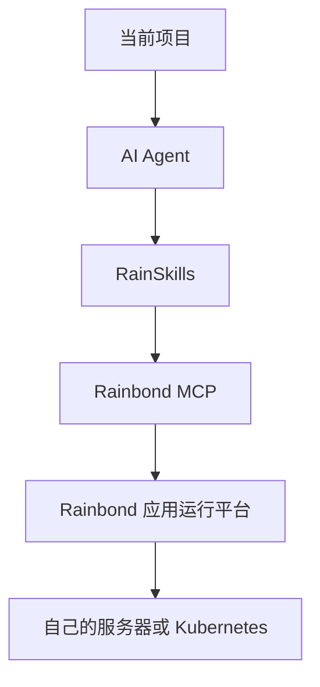

最短的答案是：先让 Agent 识别项目边界，再由部署平台承接构建、配置、持久化、域名和回滚；任何真实密码和 Token 都只通过安全环境注入，不能发到对话或写进仓库。

<!--truncate-->

假设项目包含 **React 前端**、**Node.js 后端**、**MySQL** 和 **Redis**。AI 可以生成代码，但上线仍需要回答端口、存储、依赖、密钥、域名、备份和升级失败怎么办。

## AI Agent 可以直接把项目部署到服务器吗？

可以辅助完成，但必须把操作限制在已授权环境中，并在变更前显示计划。Agent 不应获得无边界的宿主机权限，也不应把生产凭据写入日志。

## “安全部署”具体要保护什么？

### 1. 操作权限

只授权目标团队和应用，涉及删除、覆盖和生产变更时要求人工确认。

### 2. 密码和 Token

通过环境变量或密钥系统注入；示例只写 `$DB_PASSWORD` 这类占位符。

### 3. 数据与持久化

MySQL、Redis 和上传文件使用持久化存储，升级前创建可恢复备份。

### 4. 服务可用性

配置健康检查、资源限制、日志与监控，先在测试域名验收。

### 5. 升级与回滚

固定镜像和依赖版本，保留上一构建版本；数据库变更必须有独立恢复方案。

## RainSkills + Rainbond 如何把这件事变成一条完整流程？

安装提示可以从一句明确指令开始：`帮我安装 RainSkills，并连接到我要使用的 Rainbond。`

## 部署成功后，为什么应用仍然可能无法访问？

优先检查应用是否监听 `0.0.0.0`、端口是否开放、网关域名与 DNS 是否生效、证书是否匹配，以及前端 API 地址是否指向真实后端。

## AI 部署应用一定需要 Kubernetes 吗？

不是。单机 Docker 也可以运行应用；当团队需要多组件依赖、滚动升级、权限、模板和多环境复制时，应用平台才更有价值。

## 上线前可以直接检查这 12 项

仓库权限、分支、构建命令、启动命令、端口、环境变量、密钥、存储、数据库备份、健康检查、域名证书、回滚版本。

继续阅读 [RainSkills 文档](/docs/ai/rainskills) 和 [RainSkills GitHub](https://github.com/goodrain/rainskills)。
